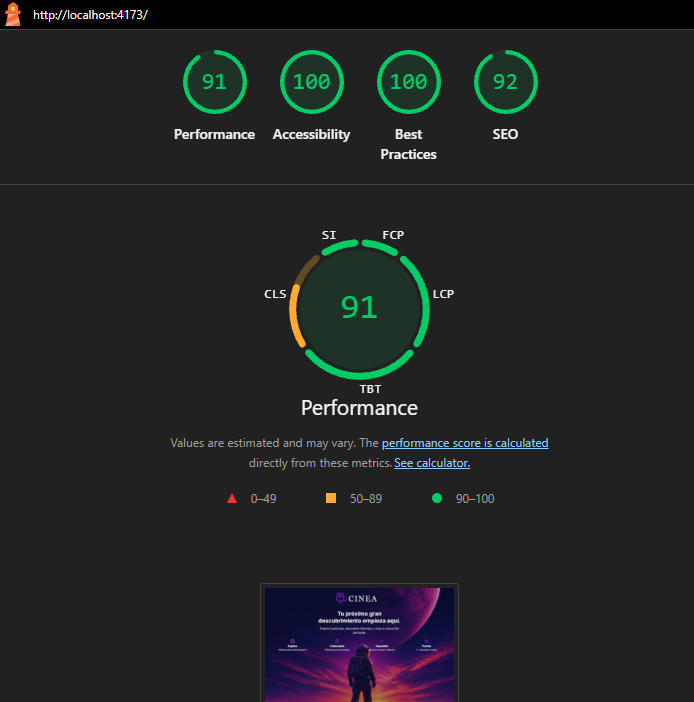
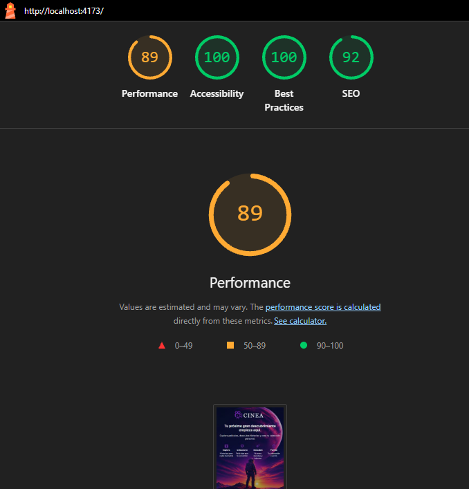
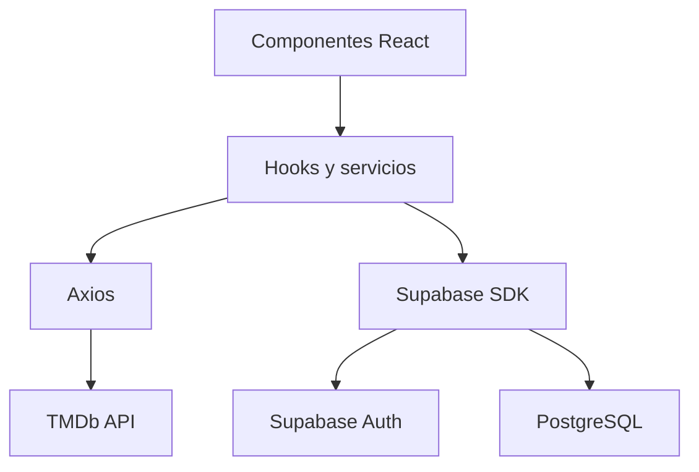

# 🎬 CINEA

**Explora. Descubre. Colecciona.**

CINEA es una aplicación web de cine que permite descubrir películas, consultar información sobre actores y directores, guardar favoritos y registrar valoraciones personales.

Desarrollada en equipo como proyecto formativo de frontend en IT Academy Barcelona, combina React y TypeScript con la API de TMDb y Supabase, siguiendo un diseño responsive **mobile-first**.

## 🎬 Demo de CINEA

[<video controls src="public/Demo.mp4" title="Title"></video>](https://github.com/user-attachments/assets/c797a2cd-7357-496b-bf10-dc1f468233d5)

## Funcionalidades

- **Catálogo:** búsqueda por título, filtros por género y puntuación, tendencias y carga dinámica de resultados.
- **Detalle de películas:** sinopsis, ficha técnica, reparto, director y tráiler oficial.
- **Actores y directores:** biografía y filmografía con navegación entre fichas.
- **Autenticación:** registro, inicio y cierre de sesión, validación de formularios y protección de rutas privadas.
- **Favoritos:** colección personal persistente, sincronizada entre las distintas vistas mediante Context API.
- **Valoraciones:** puntuaciones personales de 1 a 10 estrellas, independientes de TMDb.
- **Perfil:** información del usuario y contador de películas favoritas.
- **Experiencia de usuario:** diseño responsive, notificaciones, estados de carga y error, y controles con etiquetas accesibles.

## Tecnologías

| Área                    | Tecnologías                                   |
| ----------------------- | --------------------------------------------- |
| Frontend                | React, TypeScript, Vite                       |
| Estilos e interfaz      | Tailwind CSS, shadcn/ui, Lucide React, Sonner |
| Navegación y estado     | React Router, Context API, custom hooks       |
| API                     | Axios, TMDb API                               |
| Backend y base de datos | Supabase, PostgreSQL, Supabase Auth           |
| Testing                 | Vitest, React Testing Library, Gherkin        |
| Herramientas            | ESLint, Git, GitHub, npm                      |

## 📊 Lighthouse

Se realizaron pruebas con Lighthouse sobre la build de producción, en Chrome incógnito y sin extensiones.

**Procedimiento:**

1. `npm run build`
2. `npm run preview` (`http://localhost:4173`)
3. Análisis con Lighthouse en Chrome incógnito.

| Métrica        | Desktop | Mobile |
| -------------- | ------: | -----: |
| Performance    |      91 |     89 |
| Accessibility  |     100 |    100 |
| Best Practices |     100 |    100 |
| SEO            |      92 |     92 |

<table>
  <tr>
    <td width="50%">
      
    </td>
    <td width="50%">
      
    </td>
  </tr>
</table>

## Instalación y configuración

### Requisitos

- Node.js y npm compatibles con las dependencias del proyecto.
- Clave de API de TMDb.
- Proyecto Supabase configurado.

```bash
git clone https://github.com/movies-dev-team/movies.git
cd movies
npm ci
```

Crear un archivo `.env.local` en la raíz:

```dotenv
VITE_TMDB_API_KEY=tu_clave_de_tmdb
VITE_SUPABASE_URL=https://tu-proyecto.supabase.co
VITE_SUPABASE_PUBLISHABLE_KEY=tu_clave_publicable_de_supabase
```

Supabase debe disponer de autenticación mediante correo y contraseña, las tablas `profiles`, `favorites` y `reviews`, sus relaciones, restricciones de unicidad, políticas RLS y el trigger de creación de perfiles.

No incluir credenciales privadas ni claves `service_role` en variables `VITE_` o en el repositorio.

```bash
npm run dev
```

Abrir la URL indicada por Vite en la terminal.

| Comando            | Descripción                          |
| ------------------ | ------------------------------------ |
| `npm run build`    | Generar la compilación de producción |
| `npm run preview`  | Previsualizar la compilación         |
| `npm run lint`     | Analizar el código                   |
| `npm run test`     | Ejecutar tests en modo interactivo   |
| `npm run test:run` | Ejecutar toda la suite una vez       |

## Arquitectura

El proyecto utiliza una arquitectura **feature-based**, separando componentes, páginas, servicios, hooks y tipos según su responsabilidad.

```text
src/
├── assets/
├── components/ui/
├── data/
├── features/
│   ├── auth/
│   ├── catalog/
│   ├── details/
│   ├── favorites/
│   └── profile/
├── layout/
├── lib/
├── pages/
├── router/
├── shared/
└── test/
```

Estructura simplificada. Los textos de interfaz se centralizan en `content.json` y las importaciones utilizan el alias `@/`.



## Integración con servicios externos

### TMDb

La información cinematográfica se obtiene mediante Axios y una instancia HTTP compartida. TMDb proporciona películas, géneros, imágenes, reparto, filmografías y tráilers.

### Supabase

Supabase gestiona la autenticación y la persistencia de los datos personales sin necesidad de mantener un servidor backend propio.

| Tabla        | Responsabilidad           |
| ------------ | ------------------------- |
| `auth.users` | Identidad y autenticación |
| `profiles`   | Información del usuario   |
| `favorites`  | Películas guardadas       |
| `reviews`    | Valoraciones personales   |

Las rutas privadas se protegen mediante layouts y cambios de sesión. Las políticas **Row Level Security (RLS)** restringen el acceso a los datos según el usuario autenticado.

Los favoritos utilizan `FavoritesProvider`, `useFavorites` y `favoritesService` para compartir y persistir el estado. Las valoraciones utilizan `upsert` para insertar o actualizar una puntuación sin duplicar registros. Los identificadores `movie_id` permiten recuperar los detalles desde TMDb sin duplicar información cinematográfica.

## Testing

Se utilizan Vitest y React Testing Library para pruebas unitarias y de integración del frontend, con mocks de los servicios externos. Los escenarios Gherkin documentan los comportamientos esperados.

Las pruebas abarcan componentes, servicios, hooks, favoritos, detalles de películas y personas, y valoraciones.

```bash
npm run test:run
```

### Resultados registrados

Última ejecución local documentada (26/11/2026):

- **371/371 pruebas aprobadas.**
- **30/30 archivos de pruebas aprobados.**

Cobertura del módulo Details:

| Indicador  | Cobertura |
| ---------- | --------: |
| Sentencias |   62,89 % |
| Ramas      |   58,69 % |
| Funciones  |   50,92 % |
| Líneas     |   63,03 % |

Los resultados se han obtenido mediante Vitest y el proveedor de cobertura V8. La cobertura global del proyecto supera ampliamente el umbral mínimo del 20 % establecido en la rúbrica de evaluación.

## Flujo de trabajo

Desarrollo colaborativo mediante Git y GitHub, utilizando `main` como rama principal, `develop` como rama de integración y ramas independientes para funcionalidades y pruebas. Los cambios se integran mediante Pull Requests y commits siguiendo Conventional Commits.

## Equipo

Proyecto colaborativo desarrollado en IT Academy Barcelona.

- [Alejandro Felipe Acuña](https://github.com/alefelipin)
- [Matias Aejandro Rodriguez](https://github.com/alejandro64rodriguez-dotcom)
- [Yanet Pérez Montes de Oca](https://github.com/ypmodev)

## 🌐 Proyecto desplegado
🚀 [Ver CINEA en producción](https://movies-pi-smoky.vercel.app/)

## Créditos

La información cinematográfica y las imágenes proceden de The Movie Database (TMDb).

This product uses the TMDB API but is not endorsed or certified by TMDB.
